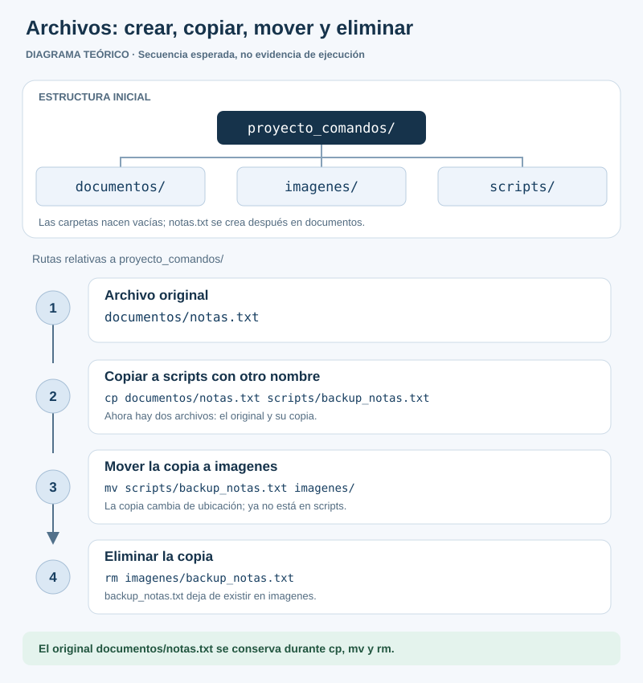
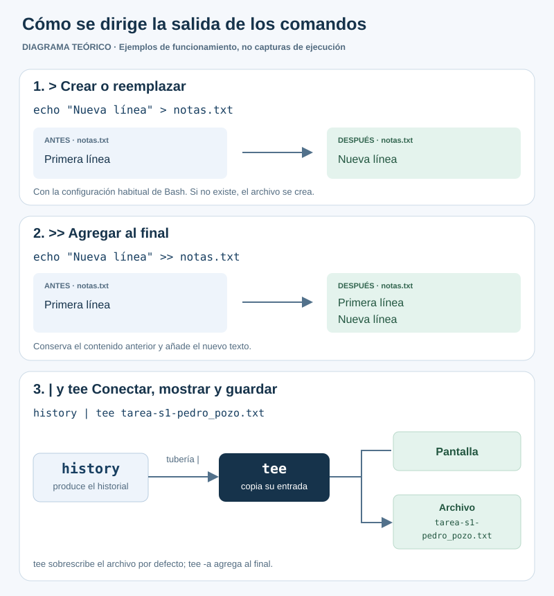
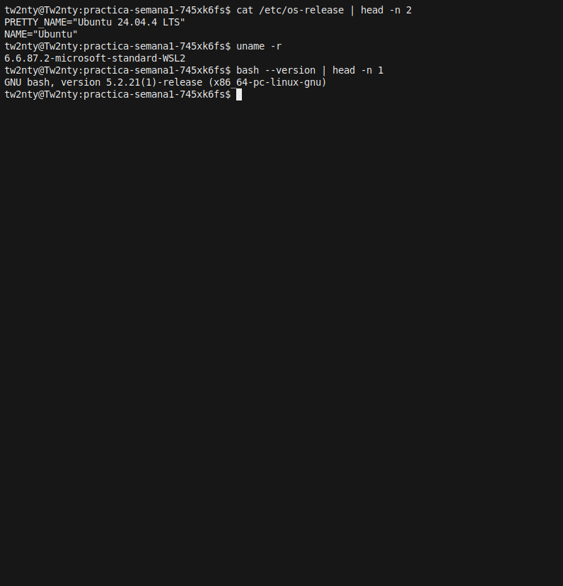
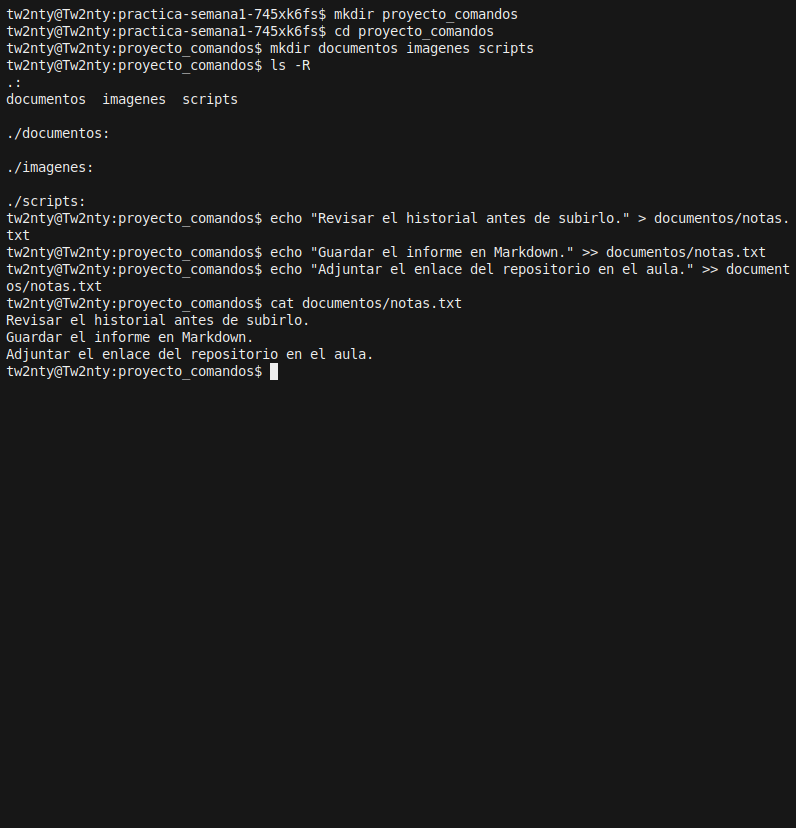
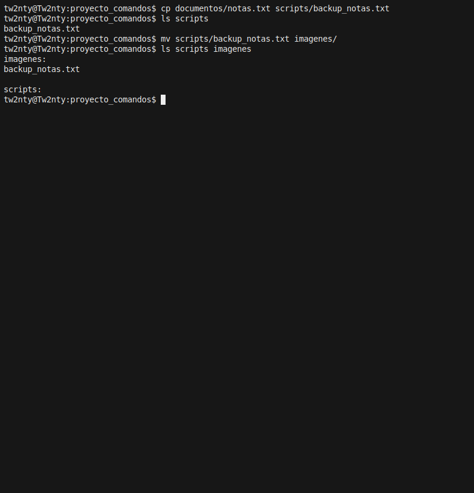
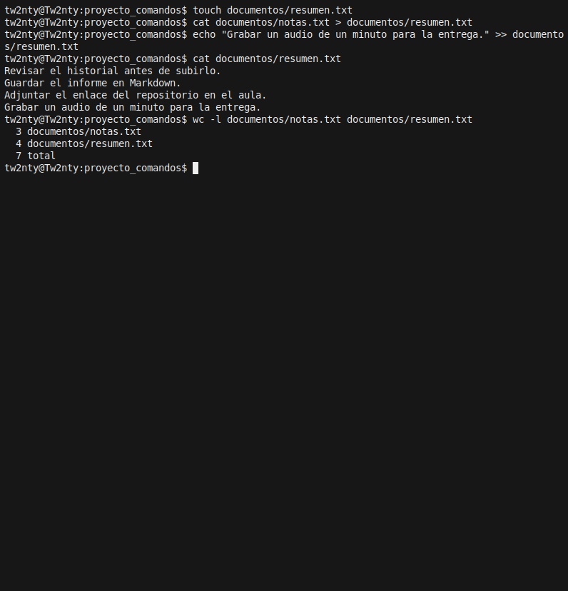
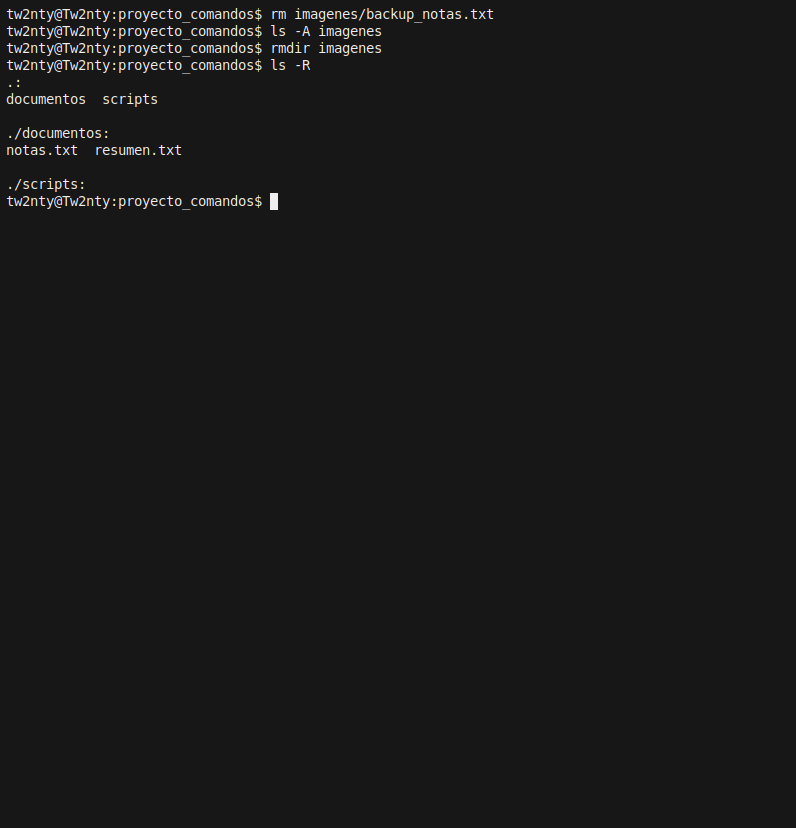
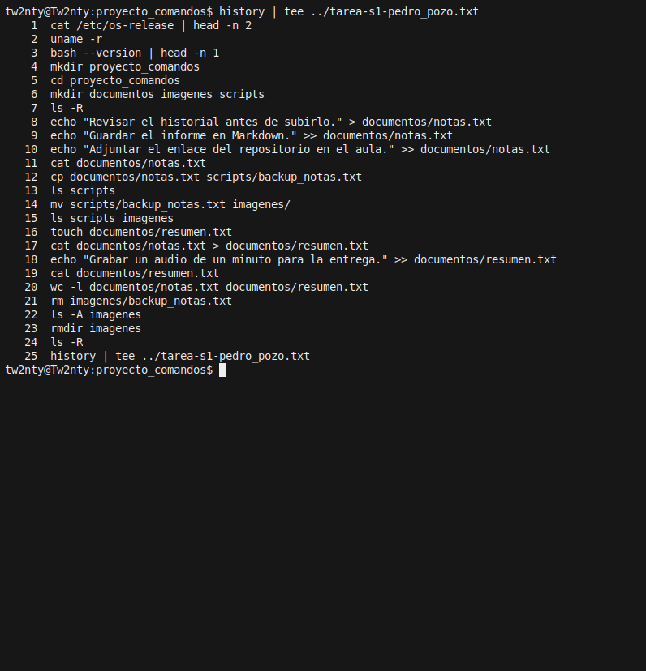

# Práctica N.º 1: Comandos de Linux

**Estudiante:** Pedro Pozo  
**Semana:** 1  
**Fecha de ejecución:** 13 de octubre de 2026  
**Entorno utilizado:** Ubuntu 24.04.4 LTS en WSL2 (Bash 5.2.21).

## 1. Título

Creación y manejo de archivos con comandos de Linux.

## 2. Tiempo de duración

No se registró una duración total de la práctica.

## 3. Fundamentos

La práctica organiza el trabajo en una carpeta llamada `proyecto_comandos`. Dentro se crean `documentos`, `imagenes` y `scripts`. El comando `mkdir` permite crear estas carpetas y `cd proyecto_comandos` sirve para entrar en la principal. Desde allí, la ruta `documentos/notas.txt` indica que el archivo está dentro de `documentos`. Tener clara la ubicación ayuda a copiar o borrar el archivo correcto. [Bash](https://www.gnu.org/software/bash/manual/bash.html) y [GNU: mkdir](https://www.gnu.org/software/coreutils/manual/html_node/mkdir-invocation.html).

Para escribir las notas se usa `echo`. La primera línea, “Revisar el historial antes de subirlo.”, se guarda con `>`. Las siguientes, “Guardar el informe en Markdown.” y “Adjuntar el enlace del repositorio en el aula.”, se añaden con `>>`. La diferencia es importante: en la configuración habitual, `>` reemplaza el contenido existente, mientras que `>>` conserva lo anterior y escribe al final. Ambos pueden crear el archivo si todavía no existe. [Bash](https://www.gnu.org/software/bash/manual/bash.html).

Con `cp documentos/notas.txt scripts/backup_notas.txt` se obtiene una copia con otro nombre y se conserva el original. Luego, `mv scripts/backup_notas.txt imagenes/` traslada esa copia. Después del movimiento, el respaldo queda en `imagenes` y ya no está en `scripts`. El archivo `documentos/notas.txt` sigue en su lugar. [GNU Coreutils](https://www.gnu.org/software/coreutils/manual/coreutils.html).

El comando `cat documentos/notas.txt > documentos/resumen.txt` escribe las tres notas en `resumen.txt`. Después se añade “Grabar un audio de un minuto para la entrega.” mediante `echo` y `>>`. Así, el archivo debe tener cuatro líneas. Aunque se llame “resumen”, `cat` no reduce ni interpreta el texto; lo envía completo al destino indicado. [GNU: cat](https://www.gnu.org/software/coreutils/manual/html_node/cat-invocation.html).

La eliminación se hace en dos pasos. Primero, `rm imagenes/backup_notas.txt` borra el respaldo. Luego, `rmdir imagenes` elimina la carpeta, siempre que esté vacía. El orden importa porque `rmdir` no elimina un directorio que todavía contiene archivos. [GNU Coreutils](https://www.gnu.org/software/coreutils/manual/coreutils.html) y [GNU: rmdir](https://www.gnu.org/s/coreutils/manual/html_node/rmdir-invocation.html).

Finalmente, `history | tee ../tarea-s1-pedro_pozo.txt` permite revisar y guardar los comandos. La tubería `|` pasa el historial a `tee`, que lo muestra en pantalla y lo escribe en el archivo. `../` sitúa ese archivo un nivel por encima de la carpeta actual. El historial sirve como registro de los comandos, pero sus resultados se comprueban aparte. [GNU: historial](https://www.gnu.org/s/bash/manual/html_node/Bash-History-Facilities.html) y [GNU: tee](https://www.gnu.org/s/coreutils/manual/html_node/tee-invocation.html).



*Figura 1. Diagrama conceptual de la estructura inicial y de las operaciones sobre la copia de notas.txt.*



*Figura 2. Diagrama conceptual de la redirección, la adición y la tubería con tee.*

## 4. Conocimientos previos

- Abrir una terminal y escribir un comando con sus argumentos.
- Reconocer la diferencia entre un archivo y un directorio.
- Saber en qué carpeta se está trabajando y cómo escribir una ruta.
- Usar comillas cuando el texto contiene espacios.
- Utilizar un navegador y una cuenta de GitHub para entregar el repositorio.

## 5. Objetivos a alcanzar

1. Crear la estructura `proyecto_comandos` con las carpetas `documentos`, `imagenes` y `scripts`.
2. Crear un archivo de tres líneas, copiarlo, cambiar el nombre de la copia y moverla a otra carpeta.
3. Añadir texto sin borrar lo anterior, eliminar el respaldo y guardar el historial con una tubería.

## 6. Equipo necesario

- Computador con Windows y WSL2 habilitado.
- Ubuntu **24.04.4 LTS** en WSL2, con kernel **6.6.87.2-microsoft-standard-WSL2** y Bash **5.2.21**.
- Git instalado para publicar el repositorio.
- Editor de texto compatible con Markdown.
- Navegador, conexión a Internet y cuenta de GitHub.
- Micrófono o teléfono para grabar el audio personal solicitado.

La práctica se ejecutó en Ubuntu mediante WSL2. Se utilizó la terminal xterm para introducir los comandos y capturar sus resultados.

## 7. Material de apoyo

- Enunciado de la tarea autónoma de la semana 1, proporcionado en el aula virtual.
- [Plantilla del informe de la asignatura](https://github.com/maguaman2/informe-tendencias/blob/main/informe.md).
- [Manual de Bash](https://www.gnu.org/software/bash/manual/bash.html).
- [Manual de GNU Coreutils](https://www.gnu.org/software/coreutils/manual/coreutils.html).
- [Documentación de tee](https://www.gnu.org/s/coreutils/manual/html_node/tee-invocation.html).

## 8. Procedimiento

La práctica se hizo en una carpeta nueva dentro de Ubuntu en WSL2. Se usó `imagenes` sin tilde en todas las instrucciones para mantener el mismo nombre de carpeta.

Las dos primeras figuras explican las operaciones. Las figuras 3 a 8 son capturas reales de la terminal xterm de Ubuntu en WSL2. Las imágenes se presentan con un ancho máximo de 800 píxeles.



*Figura 3. Identificación de Ubuntu 24.04.4 LTS, el kernel de WSL2 y la versión de Bash en la terminal.*

### Paso 1. Crear la estructura de carpetas

```bash
mkdir proyecto_comandos
cd proyecto_comandos
mkdir documentos imagenes scripts
ls -R
```

Con `ls -R` se comprobó que las tres subcarpetas estaban creadas. Los pasos siguientes se hicieron desde `proyecto_comandos`.

### Paso 2. Crear notas.txt y escribir tres líneas

```bash
echo "Revisar el historial antes de subirlo." > documentos/notas.txt
echo "Guardar el informe en Markdown." >> documentos/notas.txt
echo "Adjuntar el enlace del repositorio en el aula." >> documentos/notas.txt
cat documentos/notas.txt
```

Las notas contienen tres recordatorios para la entrega. La primera línea creó el archivo con `>`; las otras dos se añadieron con `>>`. Luego se revisó el contenido con `cat`.



*Figura 4. Captura de la creación de las carpetas y de las tres líneas de notas.txt en Ubuntu.*

### Paso 3. Copiar, renombrar y mover el archivo

```bash
cp documentos/notas.txt scripts/backup_notas.txt
ls scripts
mv scripts/backup_notas.txt imagenes/
ls scripts imagenes
```

El original quedó en `documentos` y su copia se guardó como `backup_notas.txt`. Después de moverla, `ls` mostró el respaldo dentro de `imagenes`; `scripts` quedó vacía.



*Figura 5. Captura de la copia con otro nombre y su traslado a imagenes.*

### Paso 4. Redireccionar y añadir contenido

```bash
touch documentos/resumen.txt
cat documentos/notas.txt > documentos/resumen.txt
echo "Grabar un audio de un minuto para la entrega." >> documentos/resumen.txt
cat documentos/resumen.txt
wc -l documentos/notas.txt documentos/resumen.txt
```

Se creó `resumen.txt` y se copiaron las tres notas mediante `cat` y `>`. Después se añadió el recordatorio de grabar el audio. La comprobación con `wc -l` dio **3 líneas en notas.txt y 4 en resumen.txt**.



*Figura 6. Captura del contenido de resumen.txt y de la comprobación del número de líneas.*

### Paso 5. Eliminar el respaldo y la carpeta vacía

```bash
rm imagenes/backup_notas.txt
ls -A imagenes
rmdir imagenes
ls -R
```

Después de borrar el respaldo, `ls -A imagenes` no mostró ningún archivo. Con la carpeta vacía se pudo usar `rmdir`. Las notas y el resumen se conservaron en `documentos`.



*Figura 7. Captura de la eliminación del respaldo y de la estructura final de la práctica.*

### Paso 6. Guardar el historial utilizando una tubería

El historial se guardó desde `proyecto_comandos` con este comando:

```bash
history | tee ../tarea-s1-pedro_pozo.txt
```

La tubería pasa la salida de `history` a `tee`. Así, la lista aparece en la terminal y queda guardada en `tarea-s1-pedro_pozo.txt`. El archivo se coloca fuera de `proyecto_comandos`, junto al informe.



*Figura 8. Captura de la exportación del historial de la sesión de Ubuntu mediante history y tee.*


### Paso 7. Preparar el repositorio y el audio

El informe, el historial y los archivos quedaron en el [repositorio de la práctica](https://github.com/pozosaurio-stack/tarea-semana-1-comandos-linux). El audio personal de **60 segundos en MP3** todavía debe grabarse y adjuntarse por separado en el aula virtual.

## 9. Resultados esperados

Estas fueron las comprobaciones al terminar:

| Comprobación | Resultado observado |
|---|---|
| Creación de documentos, imagenes y scripts | Las tres carpetas se crearon y se listaron. |
| Creación de notas.txt | Se verificaron tres líneas. |
| Copia con otro nombre | Se creó scripts/backup_notas.txt. |
| Movimiento del respaldo | La copia apareció en imagenes y dejó de estar en scripts. |
| Redirección y adición | resumen.txt conservó las tres líneas originales y añadió una cuarta. |
| Eliminación del respaldo | backup_notas.txt fue eliminado. |
| Eliminación de imagenes | rmdir se ejecutó después de comprobar que estaba vacía. |
| Historial mediante tubería | El historial real se guardó con history y tee. |

La estructura al terminar la práctica fue:

```text
proyecto_comandos/
├── documentos/
│   ├── notas.txt
│   └── resumen.txt
└── scripts/
```

Git no guarda carpetas vacías. Por eso, después de la práctica se añadió `.gitkeep` en `scripts` para que aparezca en el repositorio.

La comprobación más clara está en los dos archivos finales: las notas conservan los tres recordatorios y el resumen tiene uno más. La copia temporal ya no está. Esto permite revisar que cada comando produjo el cambio esperado sin perder el archivo original.

## 10. Bibliografía

- Free Software Foundation. (s. f.). *Bash reference manual*. https://www.gnu.org/software/bash/manual/bash.html
- Free Software Foundation. (s. f.). *GNU coreutils manual*. https://www.gnu.org/software/coreutils/manual/coreutils.html
- Free Software Foundation. (s. f.). *Redirections*. En *Bash reference manual*. https://www.gnu.org/software/bash/manual/html_node/Redirections.html
- Free Software Foundation. (s. f.). *Pipelines*. En *Bash reference manual*. https://www.gnu.org/software/bash/manual/html_node/Pipelines.html
- Free Software Foundation. (s. f.). *tee: Redirect output to multiple files or processes*. En *GNU coreutils manual*. https://www.gnu.org/s/coreutils/manual/html_node/tee-invocation.html
- maguaman2. (s. f.). *Plantilla de informe de práctica* [Repositorio de GitHub]. https://github.com/maguaman2/informe-tendencias
